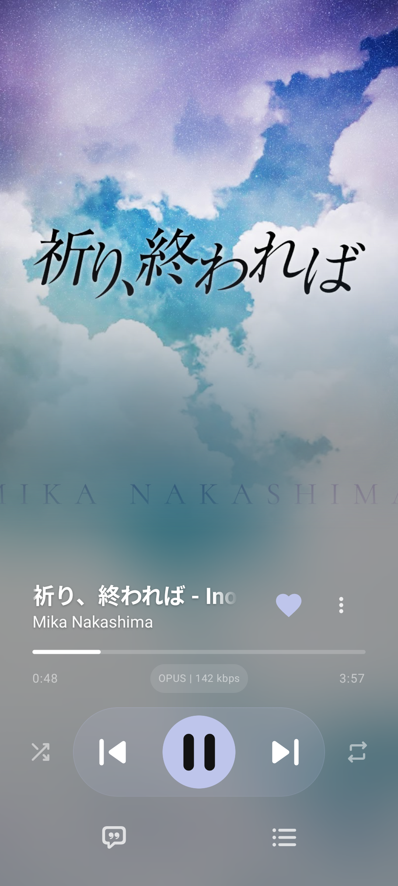
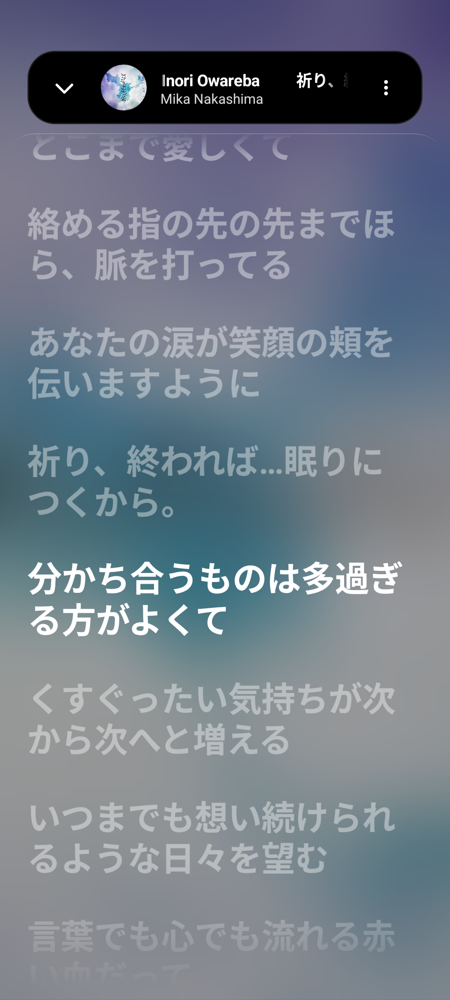
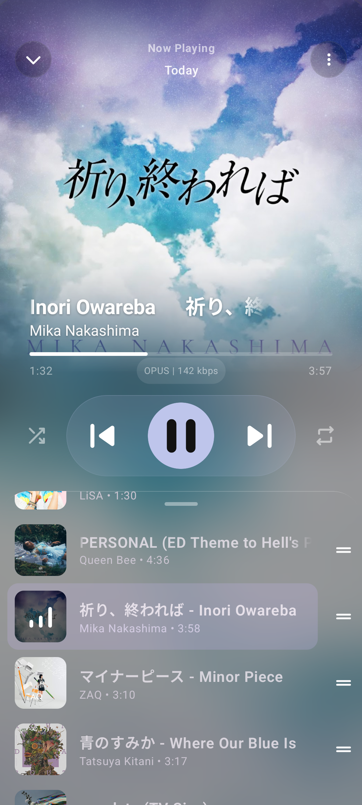
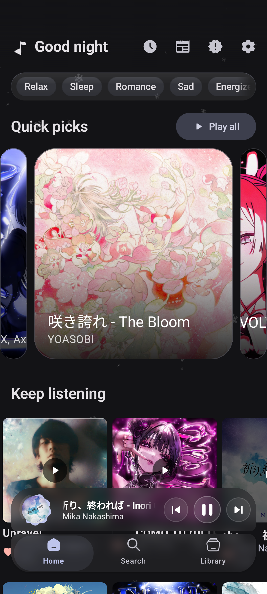
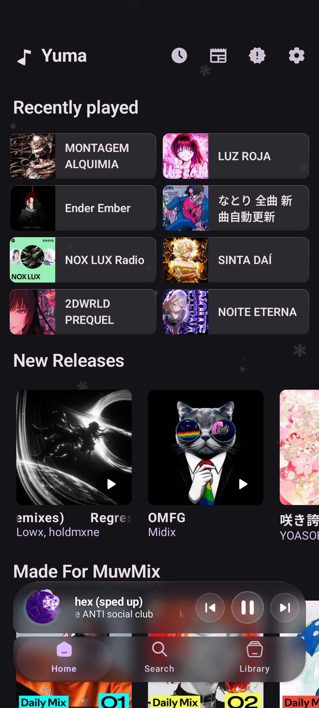

<div align="center">


  <h1>YumaPlayer (Yuma)</h1>

   <p align="center">
    <a href="README.md">
      
    </a>
    <a href="README_RU.md">
      
    </a>
  </p>

  <p>
    <strong>A hybrid music client for Android focused on usability, clean aesthetics, and audiophile-grade sound.</strong><br>
    <em>Spotify UI + Discovery Algorithms + YouTube Music Library + Hi-Res Lossless (FLAC) + Smart Automix.</em>
  </p>

  <p>
    <a href="#-showcase">Showcase</a> •
    <a href="#-key-features">Features</a> •
    <a href="#-architecture--tech-stack">Architecture</a> •
    <a href="#-download--installation">Download</a> •
    <a href="#-contributing">Contributing</a> •
    <a href="#-support-the-project">Support</a>
  </p>

 <div>
      
      
      
      
      
      <a href="https://t.me/yumaplayer"></a>
    </div>
  
  </div>
  
  <p align="center">
    <a href="https://trendshift.io/repositories/202305?utm_source=trendshift-badge&amp;utm_medium=badge&amp;utm_campaign=badge-trendshift-202305" target="_blank" rel="noopener noreferrer">
      
    </a>
  </p>

</div>

---

## 🌟 About the Project

**YumaPlayer** is an independent, open-source Android music player that unites the libraries and recommendation features of two leading streaming services alongside standalone local playback in Hi-Res quality.

The project evolved as a comprehensive rebuild of **ArchiveTune** (with foundations from **Metrolist** and **SimpMusic**), inspired by **PixelPlayer's** queue mechanics, **Meld's** Spotify integration pipeline, and **Stash's** FLAC architecture. On top of this base, YumaPlayer implements a modular 20-module architecture, a dedicated low-level audio DSP engine, the custom **YDS 2.1** design system, and hardware-accelerated fluid gesture physics.

No subscriptions. No advertisements. Zero telemetry, crash reporters, or third-party trackers. All credentials live exclusively on your device, encrypted with AES-256-GCM via Google Tink, and the codebase is completely open under the GNU General Public License v3.0.

---

<div align="center">
  
</div>

---

## 📸 Showcase
<div align="center">
  <table>
    <tr>
      <td width="33%" align="center">
        <br />
        <sub><b>Main Player (FLAC & Glass)</b></sub>
      </td>
      <td width="33%" align="center">
        <br />
        <sub><b>3-Tier Synced Lyrics</b></sub>
      </td>
      <td width="33%" align="center">
        <br />
        <sub><b>Queue</b></sub>
      </td>
    </tr>
    <tr>
      <td width="33%" align="center">
        <br />
        <sub><b>Immersive Artist Poster</b></sub>
      </td>
      <td width="33%" align="center">
        <br />
        <sub><b>Telegram-Style Morphing</b></sub>
      </td>
      <td width="33%" align="center">
        <br />
        <sub><b>Home (Quick Picks & YDS)</b></sub>
      </td>
    </tr>
    <tr>
      <td width="33%" align="center">
        <br />
        <sub><b>Spotify Feed & Recommendations</b></sub>
      </td>
      <td width="33%" align="center">
        <br />
        <sub><b>Spotify Radio & Mixes</b></sub>
      </td>
      <td width="33%" align="center">
        <br />
        <sub><b>Spotify Daily Mixes</b></sub>
      </td>
    </tr>
  </table>
</div>

---

## ✨ Key Features

### 🎛️ Audio Engine & Smart Automix 
- **Dual-Deck Continuous Crossfade:** True gapless and overlapping playback using two independent, synchronized audio deck controllers with atomic role swapping. Zero silence between tracks.
- **DJ Transition Intelligence:** Automated outro/intro cue detection, energy cliff analysis, BPM matching, and complementary bass-swap filters (0.45–0.55 window).
- **Audiophile Codec Pipeline:** Dedicated 24-bit packed PCM processing, Kopus-first Opus decoding with MediaCodec fallback, and native FLAC length resolution.
- **Smart Stall Recovery:** Automatic degradation to hard cut on buffer underruns, automated stream revival upon network reconnection, and strict source-scoped cache identities.
- **N+1 Prefetching:** Seamless background caching of upcoming tracks into the local download cache.

### 🔄 Dual Mode (Spotify + YouTube Music)
- **Spotify Catalog:** In-app browsing of Spotify albums, Daily Mixes, Discover Weekly, and playlists with cross-script deduplication and locale-aware metadata.
- **YouTube Music Catalog:** Full-catalog search across YouTube Music, charts, mood & genre categories, radio stations, and fast channel switching.
- **SponsorBlock Integration:** Configurable in-app segment skipping for sponsor messages, music hooks, fillers, and subscription reminders.

### 🎧 Lossless Playback & Local Audio
- **Lossless FLAC:** Stream and download true lossless FLAC tracks (via Qobuz / QBDLX backbone integration) using your own credentials or open community resolvers.
- **Seamless Fallback:** If a track is unavailable in lossless catalogs, playback instantly routes through YouTube Music's high-bitrate stream (Opus / AAC).
- **Local Audio Engine:** Built-in player for standalone files stored on your device (FLAC, MP3, AAC, OGG, WAV).
- **Audio Tuning:** Built-in 5-band equalizer, EBU R128 loudness normalization, tempo and pitch adjustment, and a sleep timer.

### 🎨 Yuma Design System (YDS) & Fluid Motion
- **Draggable Navigation Island:** Compact floating navigation dock inspired by Telegram specifications, featuring dynamic corner morphing, scroll-hide sync, and local haptic feedback.
- **Unified Player Sheet V2:** Re-engineered gesture physics with GPU-accelerated backdrop blur (`Haze`), isolated drag layers, and independent artwork scaling.
- **Canvas Video Backdrops:** Hardware-accelerated background video loops supporting up to 4K resolution with an isolated cache.
- **Spoiler Veil:** Interactive Telegram-grade particle engine to obscure tokens and sensitive settings.
- **Dynamic Monet Theming:** Adaptive palette extraction powered by the currently playing track's artwork, tuned for strict WCAG contrast compliance.

### 🎤 Synchronized Lyrics & AI Translation
- **3-Tier Synchronized Display:** Simultaneous live display of original lyrics (Kanji / Hangul), pronunciation guide (Romaji), and translated lines.
- **Live Karaoke Scrolling:** Word-by-word and line-by-line sync pulled from 6+ providers (LRCLIB, Kugou, BetterLyrics, SimpMusic, Unison, YouLyPlus) with bounded memory allocation to prevent OOM.
- **On-the-Fly AI Translation:** Instant translation of lyrics into your preferred language right inside the player.
- **Lyrics Card Sharing:** Export and share formatted lyrics quote cards as clean images.

---

## 📥 Download & Installation

<div align="center">
  <table>
    <thead>
      <tr>
        <th align="center">GitHub Releases</th>
        <th align="center">Telegram Channel</th>
        <th align="center">Canary Channel</th>
        <th align="center">Obtainium</th>
      </tr>
    </thead>
    <tbody>
      <tr>
        <td align="center">
          <a href="https://github.com/MuwMx/YumaPlayer/releases/latest">
            
          </a>
        </td>
        <td align="center">
          <a href="https://t.me/yumaplayer">
            
          </a>
        </td>
        <td align="center">
          <a href="https://github.com/MuwMx/YumaCanary">
            
          </a>
        </td>
        <td align="center">
          <a href="https://apps.obtainium.imranr.dev/redirect?r=obtainium://add/https://github.com/MuwMx/YumaPlayer">
            
          </a>
        </td>
      </tr>
    </tbody>
  </table>
</div>

### Building from Source
```bash
git clone https://github.com/MuwMx/YumaPlayer.git
cd YumaPlayer
./gradlew assembleRelease
# Built APK will be located at: app/build/outputs/apk/release/
```
*Prerequisites:* Android Studio with AGP 9.x support, JDK 21, Android SDK 37 (compileSdk/targetSdk 37, minSdk 26).

---

## 🏛️ Architecture & Tech Stack

YumaPlayer is organized as a 20-module Clean Architecture project following Unidirectional Data Flow (UDF):

- **UI & Presentation:** Jetpack Compose, YDS 2.1 design tokens, GPU-accelerated Haze overlays, fluid gesture physics.
- **Audio Engine:** Media3 (ExoPlayer), `:core:audio-dsp` (Smart Automix, dual-deck continuous crossfader, DJ filter cascade).
- **Network & Ingestion:** `:core:innertube` (YouTube Music engine), Ktor/Retrofit, SOCKS5 proxy support with JVM Authenticator.
- **Storage & Security:** Room ORM, hardware-backed secure preferences (AES-256-GCM via Google Tink).

📖 **Detailed Developer Documentation:**
- [Architecture Overview & Module Graph](docs/architecture/ARCHITECTURE.md)
- [Architectural Decision Records (ADRs)](docs/architecture/DECISIONS.md)
- [Yuma Design System Specification (YDS 2.1)](docs/design/YDS.md)
- [Coding Standards & Rules](docs/development/YUMA_RULES.md)

---

## 🌍 Globalization & Localization

YumaPlayer is localized into multiple languages thanks to our community translators. The localization pipeline is continuously synchronized with the codebase via [Hosted Weblate](https://hosted.weblate.org/).

<div align="center">
  <a href="https://hosted.weblate.org/engage/yumaplayer/">
    
  </a>
</div>

> **Want to help translate Yuma?** No coding or Git knowledge required. Just open our [Weblate translation dashboard](https://hosted.weblate.org/engage/yumaplayer/), choose your language, and start contributing directly through your browser.

---

## ⚙️ Account Setup

YumaPlayer is fully functional out of the box without signing in. Logging in is optional and only required to sync personal playlists, likes, and recommendations:

### 🎵 Connecting Spotify
1. Open **Settings** → **Account** → **Spotify** → Tap **Log In**.
2. Sign in with your standard Spotify credentials in the secure in-app browser window.
3. Your session cookie (`sp_dc`) will be automatically captured and encrypted on your device.

### 📺 Connecting YouTube Music
Two login methods are supported:
- **Method 1 (Google Account):** Open **Settings** → **Account** → **YouTube** → Sign in using the secure in-app authentication sheet.
- **Method 2 (Token / Cookie Input):** If you use two-factor authentication or prefer manual setup, navigate to **Settings** → **Account** → **Token Editor** and paste your session cookies directly.

---

## ☕ Support the Project

YumaPlayer is free, open source, and has no ads or subscriptions. If you enjoy using the player and wish to support ongoing development:

- **Solana (SOL, USDT, USDC):**  
  `DT3ckdbNuiQMR1mrCpBXCMrhLB19GckVv3YfxsLLiF8z`
- **PayPal / Email Transfer:**  
  `muwmix.coffee@gmail.com`

---

## 📈 Star History

<p align="center">
  <a href="https://star-history.com/#MuwMx/YumaPlayer&Date">
    
  </a>
</p>

---

## 💡 Contributing

Contributions make open-source projects thrive! Whether you are fixing bugs, proposing new features, or improving docs:

- Read our **[Contribution Guidelines](CONTRIBUTING.md)** before submitting code or PRs.
- Want to translate? Head over to our **[Hosted Weblate](https://hosted.weblate.org/engage/yumaplayer/)** — no coding required.

### 👥 Contributors

<div align="center">
  <a href="https://github.com/MuwMx/YumaPlayer/graphs/contributors">
    
  </a>
</div>

---

## 🤝 Acknowledgments (Open-Source Credits)

YumaPlayer is built on the shoulders of the open-source community:

- **[ArchiveTune](https://github.com/rukamori/ArchiveTune)** — for the solid playback foundations, rich settings base, and core architecture.
- **[Meld](https://github.com/FrancescoGrazioso/Meld)** — for the conceptual breakthrough and implementation of the Spotify hybrid integration.
- **[Stash](https://github.com/rawnaldclark/Stash)** — for inspiration in organizing lossless FLAC streaming and download pipelines.
- **[Metrolist](https://github.com/mostafaalagamy/Metrolist)** & **[SimpMusic](https://github.com/maxrave-dev/SimpMusic)** — for early lyrics parsing and interface inspirations.
- **[PixelPlayer](https://github.com/theovilardo/PixelPlayer)** — for swipe kinematics ideas and queue structure.
- **[QBDLX](https://github.com/ImAiiR/QobuzDownloaderX)** — for the lossless audio streaming infrastructure.
- **[LRCLIB](https://lrclib.net/)** & **[BetterLyrics](https://better-lyrics.boidu.dev/)** — for the open synchronized lyrics databases.

---

## ⚖️ License & Legal Disclaimer

### License
YumaPlayer is free software licensed under the **GNU General Public License v3.0 (GPLv3)**.  
You may freely copy, modify, and redistribute the source code provided you preserve copyright notices and distribute derivative works under the same GPL-3.0 license.

### Disclaimer
YumaPlayer is an independent third-party client. It is **not affiliated with, endorsed by, or sponsored by Google LLC, YouTube Music, or Spotify AB**. The application is provided for personal use only as a tool for managing your own library.

---

<div align="center">
  Crafted with ❤️ and attention to every frame. Enjoy the music! 🎵
</div>
